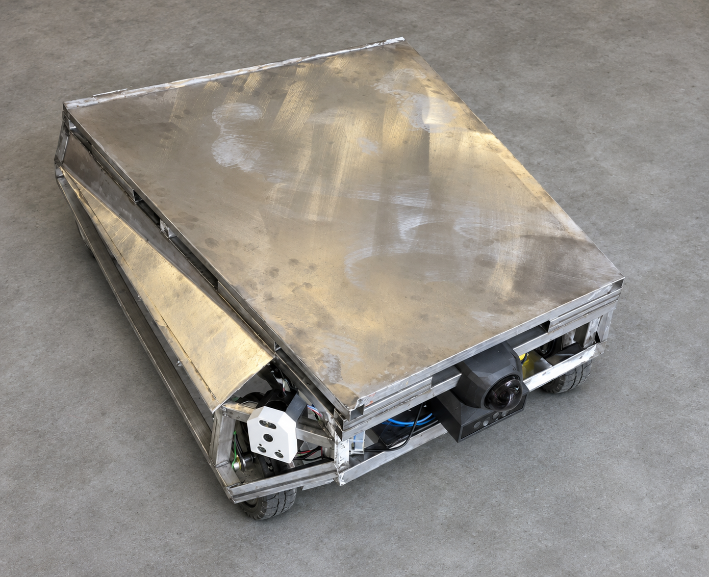
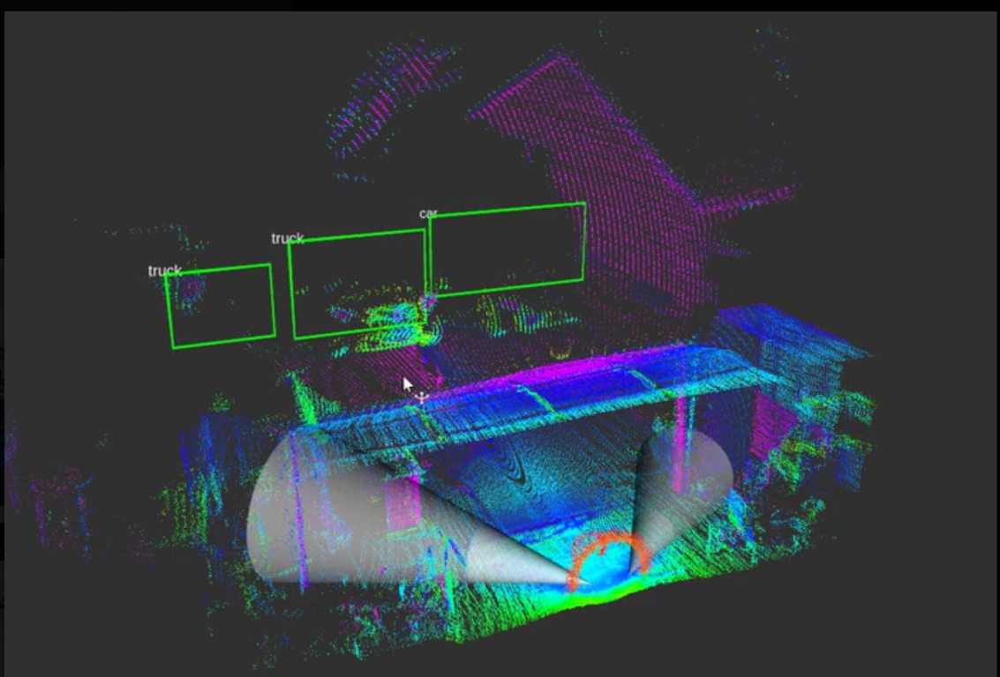
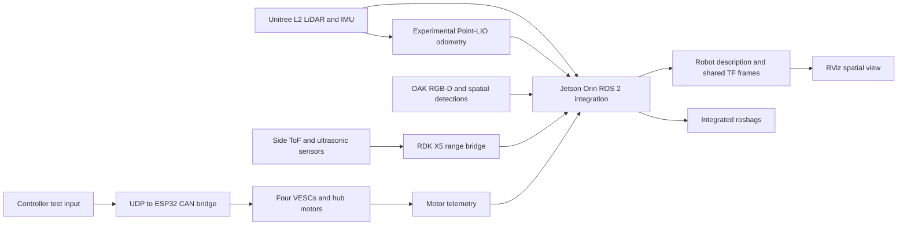
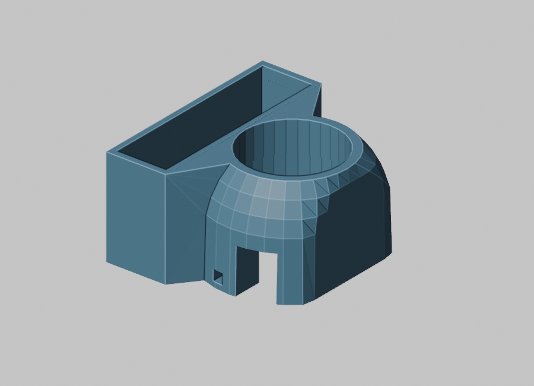
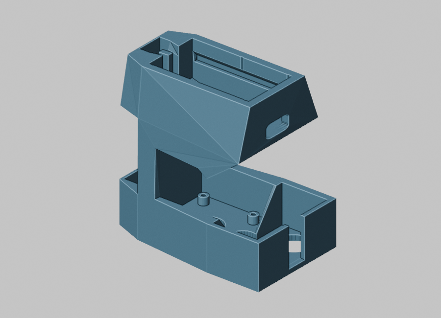

# OrinBot: from concept to a robotics stack in one semester

OrinBot was a one-semester CS 490 independent study by a two-person team: one computer science student and one engineering student. We started with a robotics architecture and parts to select, then fabricated and assembled a robot and brought its distributed sensors, compute, motor telemetry and ROS 2 frames into one inspectable system. By the end of the semester, we could see LiDAR and RGB-D point clouds, spatial detections, near-field ranges, experimental odometry and the robot model together in RViz, and record them for offline analysis. The controller was one way to verify the motor path; the main project result was the integrated sensing and compute stack.

The companion [Orinbot ROS 2 workspace](https://github.com/kenner1-unlv/Orinbot) contains the LiDAR and Point-LIO workspace and analysis scaffold. This repository holds project-specific startup, bridge and firmware files, recordings, and reproducible evidence review. It began as a CS 490 evidence package; the original course report remains a source for the build history. Construction and integration were team work. Specific individual contributions should be credited from the team's records rather than inferred from a student's degree.

| Fabrication-stage robot | Perception in RViz |
| --- | --- |
|  |  |
| Background simplified for presentation; weld cleanup and panel covering were underway. [Build photo gallery](docs/build-photo-gallery.md). | User-supplied RViz screenshot, copied unchanged. The boxes visualize detections; they are not an accuracy or tracking score. [Perception evidence](docs/perception-evaluation.md). |

## The engineering problem

We had one semester, two people and a constrained budget, with off-the-shelf parts sourced through general retailers rather than a matched robotics kit. The motors, VESCs, batteries, converters, sensors, Jetson, RDK X5, OAK and embedded boards each had their own electrical and software assumptions. We had to choose and package the batteries, separate power domains, plan fusing and conversion, fabricate harnesses, select CAN/UART/Ethernet/PoE paths, bring up a wireless controller link, and establish consistent ROS 2 topics and spatial frames. A fault could be in fabrication, power, transport, timing, TF or software. Getting the subsystems to operate together and leave inspectable recordings was the central engineering challenge.

The result was imperfect but real: a built robot with multiple edge devices publishing into a shared ROS 2 environment, visible in RViz and captured in bags. For this independent study, the practical learning came from designing interfaces, testing assumptions and debugging across mechanical, electrical and computer-science boundaries. The [evidence review](docs/bag-evidence.md) shows what was recorded; the [test plan](docs/test-plan.md) names what still needs measurement.

## One semester of progress

| Stage | What we learned and built | Inspectable result |
| --- | --- | --- |
| Architecture and component selection | Balanced cost, available parts, payload, power domains, network links and sensor roles | [Parts and engineering decisions](docs/parts-and-decisions.md) and the report's [architecture and wiring figures](docs/build-and-system-figures.md) |
| Physical construction | Fabricated and fiber-laser welded the chassis, built the tray and panels, planned battery/cargo layout, and made the wiring harnesses | [Physical build and shoulder-module figures](docs/build-and-system-figures.md) |
| Mount and enclosure iteration | Modeled and exported sensor, controller and network mounts as hardware positions and cable routes changed | [CAD and STL render gallery](docs/cad-and-mount-iteration.md) and the report's installed shoulder-module photo |
| Distributed integration | Connected Jetson Orin, OAK 4-D, Unitree L2, RDK X5 shoulder sensors and ESP32/VESC control through ROS 2, Ethernet/PoE, UART, UDP and CAN | [Startup and bridge files](system_integration/README.md), [RDK X5 bridges](rdk_x5/README.md) and recorded topics |
| Shared robot view and recordings | Added TF/robot description, RViz visualization, experimental Point-LIO output and integrated bags | [RViz figure](docs/build-and-system-figures.md#integrated-visualization), [bag inventory](docs/bag-evidence.md) and [perception measurements](docs/perception-evaluation.md) |
| Evaluation | Identified what the bags prove, where timing and odometry need work, and why the fixed-wheel steering prevented autonomous route tests | [Evidence limits](docs/bag-evidence.md) and [next tests](docs/test-plan.md) |

## What was built

| System | Implemented configuration | What the current evidence establishes |
| --- | --- | --- |
| Main compute and ROS 2 | Jetson Orin with startup services, robot description, topics, TF, RViz and rosbag recording | [Startup files](system_integration/README.md), report figures and bags show the integration structure and simultaneous recorded streams. |
| Geometric perception | Unitree L2 point cloud and IMU, selected at roughly $420 | Recorded `/unilidar/cloud` and `/unilidar/imu` streams made 3D scan timing, point density, frame alignment and experimental LiDAR-inertial odometry tangible. Demanding outdoor performance was not validated. |
| Vision perception | OAK 4-D RGB, RGB-D cloud, IMU and spatial detections | Recorded image, point cloud, detection and visualization topics. The short bag contains chair and bed labels; it does not establish person tracking. |
| Near-field sensing | Front-left and front-right shoulder heads, each with a camera, ultrasonic sensor and single-point ToF sensor, mounted around 45 degrees | ToF and ultrasonic topics recorded; [RDK X5 bridges](rdk_x5/README.md) preserve the range implementation. Shoulder image recording is not demonstrated by the five reviewed bags. |
| Motion estimate | Experimental Point-LIO `/odom_corrected` | Topic appears, but counts vary dramatically between bags. No ground-truth accuracy or drift result is available. |
| Mobile base and motor feedback | Four 500 W, 48 V-class hub motors with Flipsky 75100 V2 Pro VESCs | Movement reported by the team; four-motor telemetry appears in the bags. Tire scrub limited in-place steering; turning quality has not been measured in a controlled test. |
| Motor command check | ROS 2 `/joy` to left/right RPM groups, UDP to ESP32, extended CAN to VESCs | [Bridge code](system_integration/ros_nodes/joystick_drivers/joy_to_vesc_udp.py), [ESP32 firmware](embedded/esp32_canbus_bridge/firmware/orinbot_esp32_canbus_bridge.ino), `/joy` and VESC feedback show the manual command path. Planner control was not implemented. |

The companion workspace also has an [OAK detection and tracklet exporter](https://github.com/kenner1-unlv/Orinbot/blob/main/tools/oak_detections_app/main.py) using DepthAI `SpatialDetectionNetwork` and `ObjectTracker`, with a [ROS 2 JSON wrapper](https://github.com/kenner1-unlv/Orinbot/blob/main/tools/oak_detections_app/oak_detections_node.py). That is relevant implementation work for distance-aware object tracking. The May bags reviewed here record `/oak/nn/spatial_detections` and `/spatial_bb`, **not** the wrapper's default `/oak/detections` JSON tracklet topic. Recorded tracker IDs and person tracks remain to be demonstrated.

## System paths



The LiDAR and OAK clouds join a shared `base_link` TF graph for visualization and offline comparison. This is an integrated robot view, with experimental odometry and recorded detections; it is not yet a calibrated fused state estimate or validated obstacle tracker. The controller branch verifies motor command and feedback. No planner-to-motor path is claimed. [Perception pipeline and evidence diagram](docs/perception-evaluation.md) distinguishes the companion tracking code from what the bag records.

## Construction and engineering choices

We fabricated and fiber-laser welded the chassis, built the component tray and exterior panels, and planned the cargo and battery layout together. We made and routed the power, CAN, PoE and network harnesses, then mounted the motors, computers and sensors. We designed and 3D-printed mounts and housings as placement changed. The L2 was positioned for broad 3D geometry, the OAK for forward RGB-D perception, and the angled shoulder modules for close corner coverage. The final report describes separate drive and regulated compute/sensor power domains, plus an isolated CAN interface. These choices let subsystems be tested separately. The [build and system figures](docs/build-and-system-figures.md) preserve the team's physical-build photo, architecture diagram, integrated power/network/CAN layout, shoulder-module CAD and installed prototype, and RViz evidence. Dimensions, connector-level schematics, fuse values and measured mounting offsets still need source records before this is a fully reproducible construction package.

The [unedited report photograph](docs/build-and-system-figures.md#fabricated-platform) and the [fabrication photo gallery](docs/build-photo-gallery.md) show the physical build at different stages. The gallery's simplified backgrounds are presentation edits; the unfinished metalwork remains part of the story.

The physical layout did not arrive fully solved. We used CAD to revise brackets and cases as sensor positions, component offsets and wiring clearance changed. The [STL render gallery](docs/cad-and-mount-iteration.md) shows LiDAR, camera, VESC, PoE and CAN mounting examples; the [report's shoulder-module pair](docs/build-and-system-figures.md#custom-shoulder-sensor-module) compares a CAD view with an installed prototype.

| LiDAR mount export | Camera clip housing export |
| --- | --- |
|  |  |

*Renders of local STL exports. They illustrate design work; [source notes and other mounts](docs/cad-and-mount-iteration.md) distinguish the models from installed-part photos.*

Cost and availability shaped the drive system: scooter-style hub motors were strong, durable and inexpensive relative to purpose-built robot drive pods. The Flipsky VESCs exposed motor telemetry useful for integration tests. The wheels carried the robot and it could turn, but the fixed four-wheel skid-steer layout produced too much tire scrub for the in-place turning we wanted. The joystick program sends independent RPM commands to left and right motor pairs; it has a dead zone, ramp and loss-of-input timeout. A two-wheel drive layout with passive casters, a suitable Ackermann steering design, or independently steered versions of the existing hub-motor pods are alternatives to test. [Parts and budget record](docs/parts-and-decisions.md) separates known components and design reasons from prices that still need invoices or a bill of materials.

Ethernet and PoE were chosen for the larger sensor and edge-compute links, while the ESP32 handled low-level CAN traffic. This distributed layout kept the Orin focused on ROS 2 integration, recording and experimental odometry. It also introduced clock, transport, startup-order and calibration work that the recordings now let us inspect.

## Results and limits

The [bag evidence review](docs/bag-evidence.md) compares all five recordings. Four are about a minute; one is 9.46 seconds. They show simultaneous publication of several control and perception streams, including four VESCs. They do **not** prove that sensor clocks were synchronized, that the robot followed an autonomous path, or that it could run for an extended shift.

We ran [perception diagnostics](tools/inspect_perception_bag.py) on the 9.46-second bag. It contains 113 LiDAR clouds, 36 OAK RGB-D clouds and a TF path from both cloud frames to `base_link`. Three cloud pairs selected by header time differed by 26–37 ms. After applying the recorded TF, the sampled OAK-to-LiDAR nearest-neighbor median distances were **0.143, 0.584 and 0.393 m**. Their variation is a reason to test calibration and timing further, not a measured mounting correction. OAK cloud recording timestamps lagged their header timestamps by a median **0.827 s** in that bag, versus **0.085 s** for LiDAR. Those are queue/clock diagnostics, not a proven clock offset. The marker stream had 20 nonempty messages labeled chair or bed. Their reported 3D marker-position ranges can be calculated, but they have no surveyed ground truth, and no persistent track identity was established. See [method and limitations](docs/perception-evaluation.md).

The strongest outcome is a **physically built, distributed ROS 2 perception and compute stack** that brought multiple edge devices into a common robot view and recorded their data. Point-LIO output is experimental, and the recordings expose timing and rate anomalies worth investigating. We also added a [GPS bridge](rdk_x5/README.md#gps-hat-bridge) and began sensor cleanup work; the five reviewed bags do not establish GPS-aided navigation.

The robot moved under controller input, but four powered fixed wheels scrubbed heavily in turns and made in-place steering unsuitable for repeatable route control. We did not complete autonomous waypoint driving, calibrated fusion, or long field trials in the semester. That boundary shaped the next engineering tests; it does not diminish the integrated sensing system we built.

## Practical questions and answers

**What did I work on personally?** We worked across disciplines on nearly every subsystem. My engineering teammate led the power calculations and wiring and fuse plans. We both selected and ordered parts, fabricated and fiber-laser welded the frame, planned the cargo and battery layout, made and ran the harnesses, and assembled the robot. I led the computer side: programming, model selection, and integration with the hardware we chose.

**Why four scooter hub motors, and what did that choice teach us?** The wheels were strong, affordable and durable, and the VESCs gave us useful motor reporting. Four powered wheels moved the platform and let it turn under joystick control, but they scrubbed too much to rotate in place like the skid-steer robot we expected. Two powered wheels with casters, a properly designed Ackermann front end, or adding steering actuators to the existing hub-motor pods are better candidates for the next build. We would compare them on the same course before choosing one.

**What was the semester's actual minimum viable result?** We put in substantially more hours than the course required and got the edge devices, sensor streams, motor feedback and robot frames into a shared ROS 2/TF view in RViz. That gave us a single spatial view of the robot for inspection and recording. We also had enough of the system working to add a GPS bridge and begin sensor cleanup. This was integration of multiple data sources into a common robot frame, not validated state-estimation fusion or autonomous navigation.

**Why was this independent study valuable to me?** We had to make inexpensive, mixed-source hardware work as one physical and software system. I learned how battery and power-conversion choices, fusing, wiring, data buses, network links, sensor mounts and ROS 2 frames affect each other. The problems were not contained in one class topic, and the robot gave us real failures and data to reason from. For me, that practical learning was worth more than another elective.

**What did the LiDAR and vision work show?** Their point clouds overlapped where their fields of view intersected, and the bag analysis quantifies that overlap for three nearby-time samples. It does not yet give us a calibrated extrinsic offset or surveyed object-distance accuracy. A longer-term research goal is to classify objects directly in point clouds and compare those results with the OAK's YOLOv6-nano vision detections, using labeled ground truth rather than visual agreement alone.

**Why did we choose the Unitree L2?** At roughly $420, it was a way to learn real 3D point-cloud integration without building the project around a much more expensive LiDAR. Working with its cloud and IMU taught me about scan bands, publish rates, time alignment, coordinate frames and the challenges that lead to filtering and state estimation. We used Point-LIO experimentally; we did not complete or validate a Kalman-filtered navigation state. I would not present the L2 or our mounting as a proven high-end outdoor perception system. [Unitree's published specifications](https://www.unitree.com/L2/) describe the product under stated target and environmental conditions; our robot needs its own range, coverage and reliability tests.

**What would I change first?** I would redesign the steering module, reconsider the side sensor mounts and test an inverted LiDAR mounted higher on a mast to see whether it improves ground and around-body coverage. I am happy with the forward OAK camera and its detections; I would keep that pipeline feeding the Orin as a future planning input. The Orin is where I intend to run planning, although we have not profiled its remaining compute capacity or tested planner-driven motion. I would allocate more engineering budget to a proper test bench for power, wiring, steering and sensor calibration. For the side modules, I would explore active attention: a microphone array could estimate a sound direction, then steer a camera and ToF range sensor toward that direction for identification and distance checking. The current ToF sensors do not sense audio direction, and none of these future designs has been validated on this robot.

## Next engineering iteration

1. Measure turning on a marked course: commanded left/right RPM, VESC ERPM, yaw, turn radius, slip and repeatability, with the same surface and battery state for each trial.
2. Compare a steerable wheel module, two powered wheels with casters, or an Ackermann layout against the fixed-wheel baseline. Add steering-angle feedback and a kinematic model where needed before autonomous control.
3. Measure LiDAR-to-OAK extrinsics using a stationary target visible to both sensors at several known positions. Report translation and angular residuals with uncertainty; repeat after remounting.
4. Validate Point-LIO against surveyed displacement and heading, then investigate the bag-to-bag output-rate swings and timestamp behavior.
5. Only after reliable motion and state estimation, implement and test a planner command interface, obstacle stopping, map reuse and waypoint navigation.
6. For object or person tracking, record detection identity and range through time, compare against annotated video/ground truth, and report missed detections and identity switches. The current spatial-detection topics alone do not establish tracking.
7. Compare the current LiDAR placement against a measured inverted mast mount for ground and around-body coverage. Redesign side mounts for corner/edge sensing while retaining the forward OAK detection pipeline. Prototype microphone-guided shoulder attention only after recording sound-direction, camera-pointing and ToF-range accuracy.

A separate [NOVA20 side-mount comparison proposal](docs/near-field-sensor-upgrade.md) examines one 20-channel near-field line per orientation: a horizontal slice for corner/low-obstacle coverage and a vertical slice pitched toward the ground for drop-off observations. It would augment the current shoulder camera, ultrasonic and ToF sensors while leaving the forward OAK camera and detections in place. The cross is a proposed measurement setup, not an installed sensor, dense depth image or validated safety feature.

The [test protocol](docs/test-plan.md) defines the evidence needed for these claims.

## Reproduce the evidence review

The databases are tracked with Git LFS. `git lfs pull` can download several gigabytes; fetch a specific bag when practical. On a machine with Python 3.10+:

```bash
python -m pip install PyYAML numpy scipy rosbags
python tools/bag_summary.py rosbags/orinbot_integrated_20260507_124955
python tools/inspect_perception_bag.py rosbags/orinbot_integrated_20260507_124955/orinbot_integrated_20260507_124955_0.db3
```

The summary works from downloaded `metadata.yaml` alone; database timing columns require the `.db3`. The perception script requires that database. It does not need a running robot or ROS installation. See [system integration](system_integration/README.md), [embedded bridge](embedded/esp32_canbus_bridge/README.md), and [RDK X5 bridges](rdk_x5/README.md) for runtime details.

For ROS 2 Humble playback, source the ROS installation and project workspace, stop the live robot stack to avoid mixing topics, then run `ros2 bag play rosbags/<bag-folder> --clock`. Launch RViz with `rviz2 --ros-args -p use_sim_time:=true`; `base_link` is a useful fixed frame for the recorded clouds and transforms.
