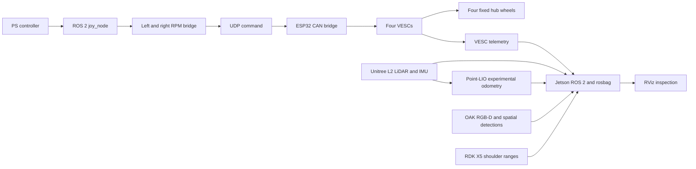

# OrinBot: a mobile robotics integration study

OrinBot was a one-semester CS 490 build by a two-person team: one computer science student and one engineering student. Together, we selected and ordered the parts, fabricated the chassis, component tray and exterior panels, assembled the robot, integrated its electronics and ROS 2 software around a Jetson Orin, and recorded the running system. It moved under joystick control. **It did not achieve reliable autonomous driving.** The four powered, fixed wheels had ample drive torque, but skid steering turned poorly and inconsistently. That mechanical control problem limited the project before waypoint navigation could be evaluated. This repository presents both the integration result and that constraint.

The companion [Orinbot ROS 2 workspace](https://github.com/kenner1-unlv/Orinbot) contains the LiDAR and Point-LIO workspace and analysis scaffold. This repository holds project-specific startup, bridge and firmware files, recordings, and reproducible evidence review. It grew out of the [CS 490 evidence repository](https://github.com/kenner1-unlv/cs490-lio-slam); the original course report remains a source for the build history. Construction and integration were team work. Specific individual contributions should be credited from the team's records rather than inferred from a student's degree.

## What was built

| System | Implemented configuration | What the current evidence establishes |
| --- | --- | --- |
| Mobile base | Four 500 W, 48 V-class hub motors with Flipsky 75100 V2 Pro VESCs | Joystick-driven movement reported in the final report; four-motor telemetry appears in the bags. Turning quality has not been measured in a controlled test. |
| Motor control | ROS 2 `/joy` to left/right RPM groups, UDP to ESP32, extended CAN to VESCs | The [bridge code](system_integration/ros_nodes/joystick_drivers/joy_to_vesc_udp.py) and [ESP32 firmware](embedded/esp32_canbus_bridge/firmware/orinbot_esp32_canbus_bridge.ino) show the path; bags contain `/joy` and VESC feedback. The current code is **tank-style joystick control**, not a Nav2 `/cmd_vel` controller. |
| Geometric perception | Unitree L2 point cloud and IMU | Recorded `/unilidar/cloud` and `/unilidar/imu` streams. |
| Vision perception | OAK 4-D RGB, RGB-D cloud, IMU and spatial detections | Recorded image, point cloud, detection and visualization topics. The short bag contains chair and bed labels; it does not establish person tracking. |
| Near-field sensing | Front-left and front-right ToF/ultrasonic modules, around 45 degrees | Range topics recorded; [RDK X5 bridges](rdk_x5/README.md) preserve the sensor-side implementation. |
| Motion estimate | Experimental Point-LIO `/odom_corrected` | Topic appears, but counts vary dramatically between bags. No ground-truth accuracy or drift result is available. |

The companion workspace also has an [OAK detection and tracklet exporter](https://github.com/kenner1-unlv/Orinbot/blob/main/tools/oak_detections_app/main.py) using DepthAI `SpatialDetectionNetwork` and `ObjectTracker`, with a [ROS 2 JSON wrapper](https://github.com/kenner1-unlv/Orinbot/blob/main/tools/oak_detections_app/oak_detections_node.py). That is relevant implementation work for distance-aware object tracking. The May bags reviewed here record `/oak/nn/spatial_detections` and `/spatial_bb`, **not** the wrapper's default `/oak/detections` JSON tracklet topic. Recorded tracker IDs and person tracks remain to be demonstrated.

## System paths



The control path shown above is the implemented joystick path. No planner-to-motor path is claimed. The LiDAR and OAK clouds join a shared `base_link` TF graph for visualization and offline comparison; there is no validated fused obstacle tracker in this repository. [Perception pipeline and evidence diagram](docs/perception-evaluation.md) distinguishes the companion tracking code from what the bag records.

## Construction and engineering choices

We fabricated the chassis, component tray and exterior panels, then mounted the hub motors, batteries, Jetson, LiDAR, OAK camera, RDK X5, PoE equipment and front-corner sensors. We designed and 3D-printed mounts and housings as placement changed, and assembled and wired the parts ourselves. The L2 was positioned for broad 3D geometry, the OAK for forward RGB-D perception, and the angled shoulder modules for close corner coverage. The final report describes separate drive and regulated compute/sensor power domains, plus an isolated CAN interface. These choices let subsystems be tested separately. The [build and system figures](docs/build-and-system-figures.md) now preserve the team's physical-build photo, architecture diagram, integrated power/network/CAN layout, shoulder-module CAD and installed prototype, and RViz evidence. Dimensions, connector-level schematics, fuse values and measured mounting offsets still need source records before this is a fully reproducible construction package.


*Physical build stage, final report Figure 2. [Figure context and source](docs/build-and-system-figures.md#fabricated-platform).*

Cost and availability shaped the drive system: commodity scooter-style hub motors and VESCs could be bought and replaced more readily than purpose-built robot drive pods. Their torque was sufficient for motion, but the fixed four-wheel skid-steer layout imposed a large turning burden. The joystick program sends independent RPM commands to left and right motor pairs; it has a dead zone, ramp and loss-of-input timeout. The resulting turn remained unreliable in practice. More torque or software tuning alone cannot be claimed as a fix without a controlled comparison. [Parts and budget record](docs/parts-and-decisions.md) separates known components and design reasons from prices that still need invoices or a bill of materials.

Ethernet and PoE were chosen for the larger sensor and edge-compute links, while the ESP32 handled low-level CAN traffic. This distributed layout kept the Orin focused on ROS 2 integration, recording and experimental odometry. It also introduced clock, transport, startup-order and calibration work that the recordings now let us inspect.

## Results and limits

The [bag evidence review](docs/bag-evidence.md) compares all five recordings. Four are about a minute; one is 9.46 seconds. They show simultaneous publication of several control and perception streams, including four VESCs. They do **not** prove that sensor clocks were synchronized, that the robot followed an autonomous path, or that it could run for an extended shift.

We ran [perception diagnostics](tools/inspect_perception_bag.py) on the 9.46-second bag. It contains 113 LiDAR clouds, 36 OAK RGB-D clouds and a TF path from both cloud frames to `base_link`. Three cloud pairs selected by header time differed by 26–37 ms. After applying the recorded TF, the sampled OAK-to-LiDAR nearest-neighbor median distances were **0.143, 0.584 and 0.393 m**. Their variation is a reason to test calibration and timing further, not a measured mounting correction. OAK cloud recording timestamps lagged their header timestamps by a median **0.827 s** in that bag, versus **0.085 s** for LiDAR. Those are queue/clock diagnostics, not a proven clock offset. The marker stream had 20 nonempty messages labeled chair or bed. Their reported 3D marker-position ranges can be calculated, but they have no surveyed ground truth, and no persistent track identity was established. See [method and limitations](docs/perception-evaluation.md).

The strongest outcome is therefore an **instrumented, joystick-driven robotics platform** with recorded multi-sensor data. The semester ended before reliable turning and autonomous navigation could be validated. Point-LIO output is experimental, and the recorded data exposes a rate anomaly that needs investigation.

## Next engineering iteration

1. Measure turning on a marked course: commanded left/right RPM, VESC ERPM, yaw, turn radius, slip and repeatability, with the same surface and battery state for each trial.
2. Compare a steerable wheel module or another mechanically viable steering design against the fixed-wheel baseline. Add steering-angle feedback and a kinematic model before autonomous control.
3. Measure LiDAR-to-OAK extrinsics using a stationary target visible to both sensors at several known positions. Report translation and angular residuals with uncertainty; repeat after remounting.
4. Validate Point-LIO against surveyed displacement and heading, then investigate the bag-to-bag output-rate swings and timestamp behavior.
5. Only after reliable motion and state estimation, implement and test a planner command interface, obstacle stopping, map reuse and waypoint navigation.
6. For object or person tracking, record detection identity and range through time, compare against annotated video/ground truth, and report missed detections and identity switches. The current spatial-detection topics alone do not establish tracking.

The [test protocol](docs/test-plan.md) defines the evidence needed for these claims.

## Reproduce the evidence review

The databases are tracked with Git LFS. `git lfs pull` can download several gigabytes; fetch a specific bag when practical. On a machine with Python 3.10+:

```bash
python -m pip install PyYAML numpy scipy rosbags
python tools/bag_summary.py rosbags/orinbot_integrated_20260507_124955
python tools/inspect_perception_bag.py rosbags/orinbot_integrated_20260507_124955/orinbot_integrated_20260507_124955_0.db3
```

The summary works from downloaded `metadata.yaml` alone; database timing columns require the `.db3`. The perception script requires that database. It does not need a running robot or ROS installation. See [system integration](system_integration/README.md), [embedded bridge](embedded/esp32_canbus_bridge/README.md), and [RDK X5 bridges](rdk_x5/README.md) for runtime details.

For ROS 2 Humble playback, source the ROS installation and project workspace, stop the live robot stack to avoid mixing topics, then run `ros2 bag play rosbags/<bag-folder> --clock`. Launch RViz with `rviz2 --ros-args -p use_sim_time:=true`; `base_link` is a useful fixed frame for the recorded clouds and transforms.
