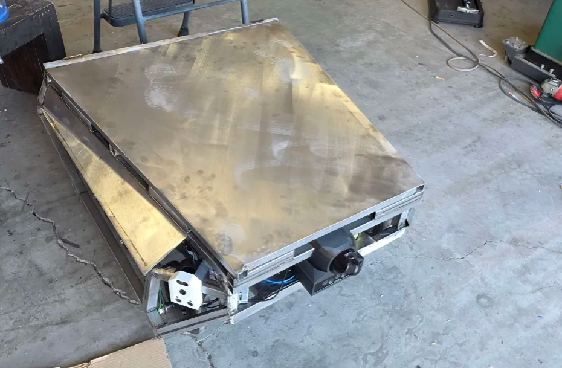
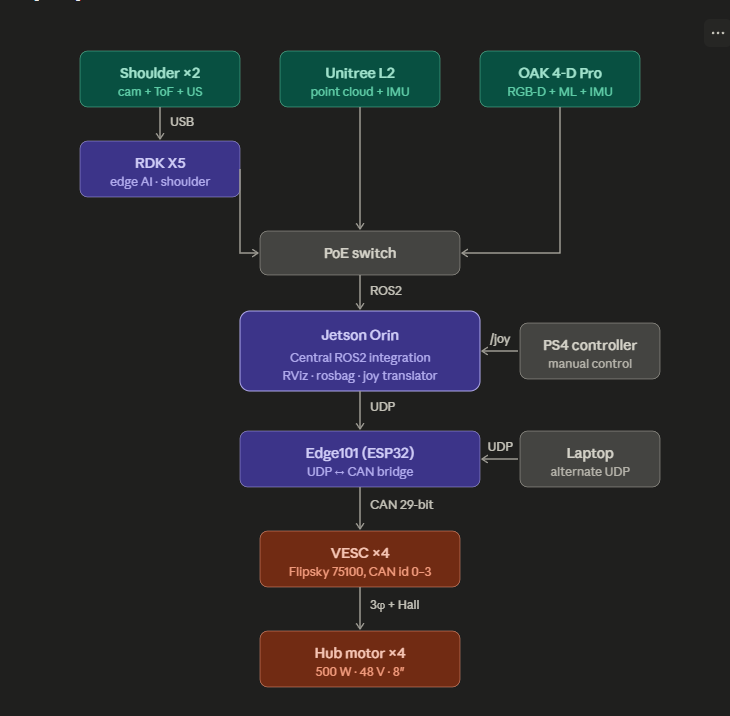
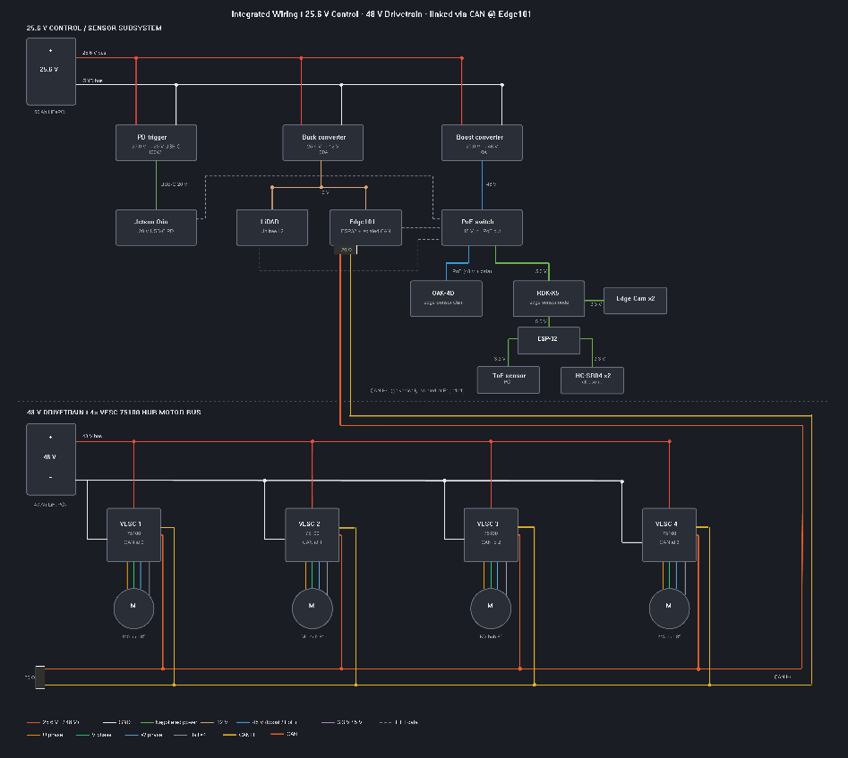
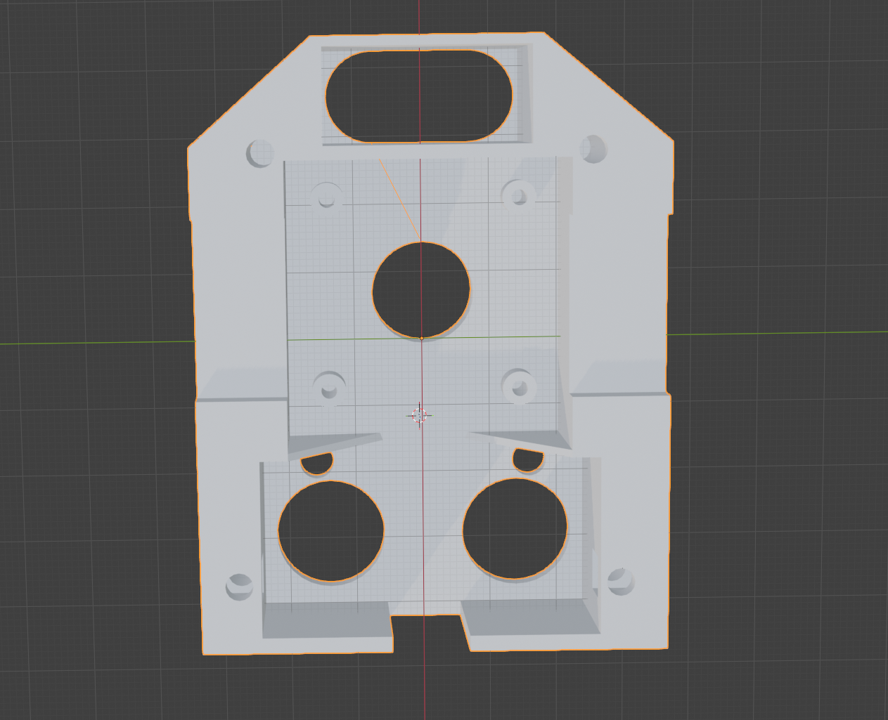
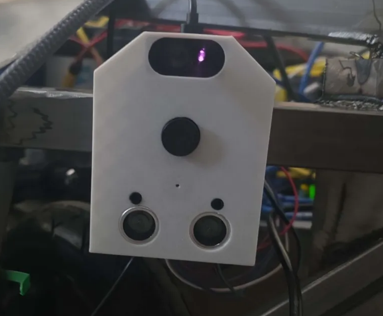
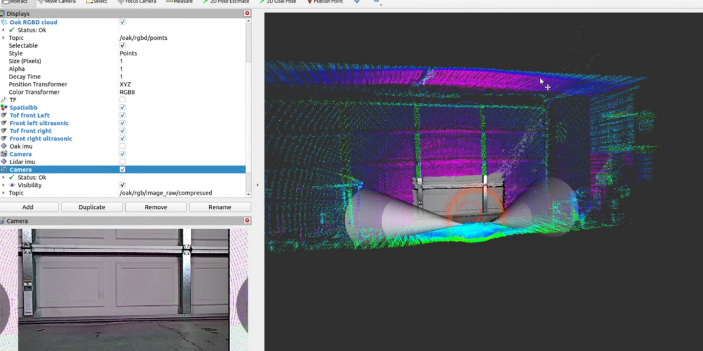
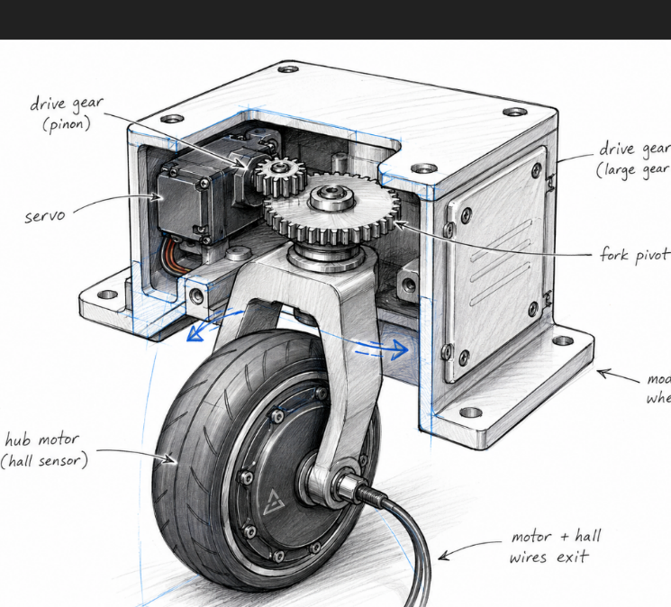
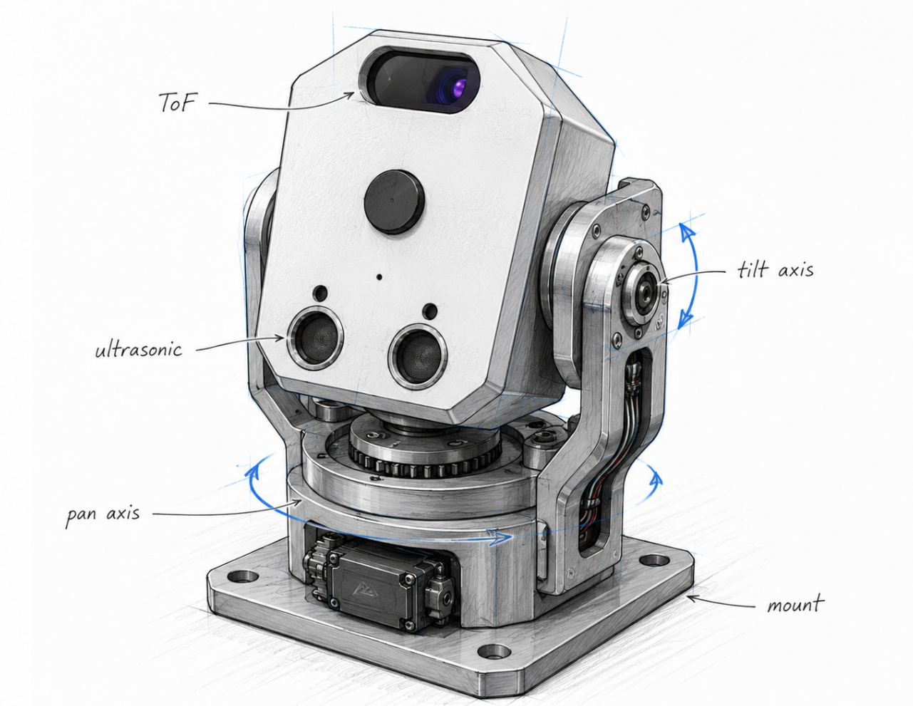
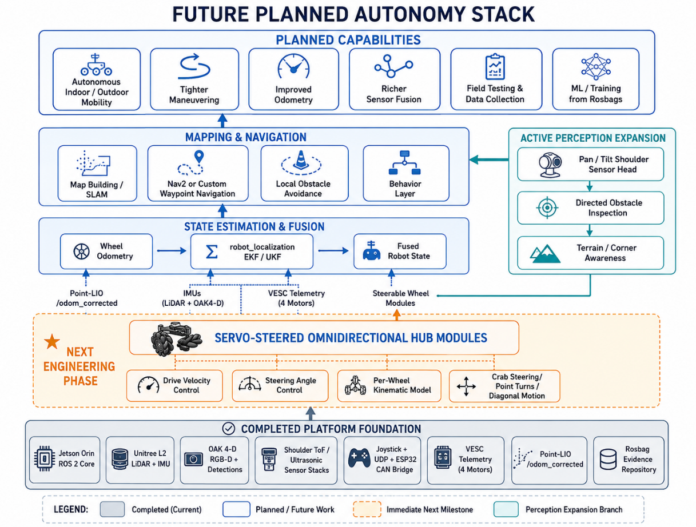

# Build and system figures from the final report

These figures were extracted unchanged from the team's May 2026 *Final Report OrinBot* Word document. Page numbers below refer to the PDF copy of that report. The report captions describe their intended subjects; the notes here distinguish physical evidence, architecture drawings, and unbuilt concepts. The images document the team's work, while exact dimensions, fuse ratings and measured calibration still require primary build records. Credit individual drawing and photography contributors when those records are available.

## Fabricated platform

*Report Figure 2, page 5.* Photograph of a physical build stage showing the chassis and exterior sheet-metal surfaces. It supports the team's account that the body was fabricated and assembled. It does not show every internal mount, electrical connection or final finish.

## System architecture

*Report Figure 3, page 9.* Team architecture diagram. It shows the intended roles and communication paths, including the implemented joystick-to-VESC route. The [README system diagram](../README.md#system-paths) was checked against preserved code and recordings; it avoids treating a drawn link as proof of timing or functional performance.

## Power, network and CAN layout

*Report Figure 4, page 10.* This is the integrated wiring and power **layout diagram** previously missing from this repository. It depicts separate 25.6 V control/sensor and 48 V drive domains, conversion and distribution blocks, the PoE/network path, ESP32/Edge101 bridge, four VESCs and four motors. It is useful construction evidence, but it is not a complete electrical schematic with verified connector pinouts, fuse values, wire gauges or regulator test data.

## Custom shoulder sensor module

| CAD view | Installed prototype |
| --- | --- |
|  |  |

*Report Figure 5, page 16.* The design and physical prototype show the team's fabricated near-field sensor housing. The associated ToF and ultrasonic ROS 2 topics are listed in the [bag review](bag-evidence.md). Exact measured sensor angle and range accuracy remain open tests.

## Integrated visualization

*Report Figure 6, page 17.* RViz screenshot of the integrated perception scene. It shows visual coexistence of point clouds and robot frames; the [quantitative bag review](perception-evaluation.md) gives measured scene-overlap diagnostics and explains why this screenshot alone does not establish extrinsic accuracy.

## Future concepts, not built results

*Report Figure 10, page 33.* Proposed wheel module addressing the fixed-wheel steering limitation. No fabricated or tested steerable pod is claimed.

*Report Figure 11, page 33.* Proposed active perception head. The installed shoulder module above is fixed-angle.

*Report Figure 12, page 34.* The team roadmap distinguishes completed integration from proposed steering, state estimation, mapping and navigation. It records design intent, not successful autonomous field trials.
