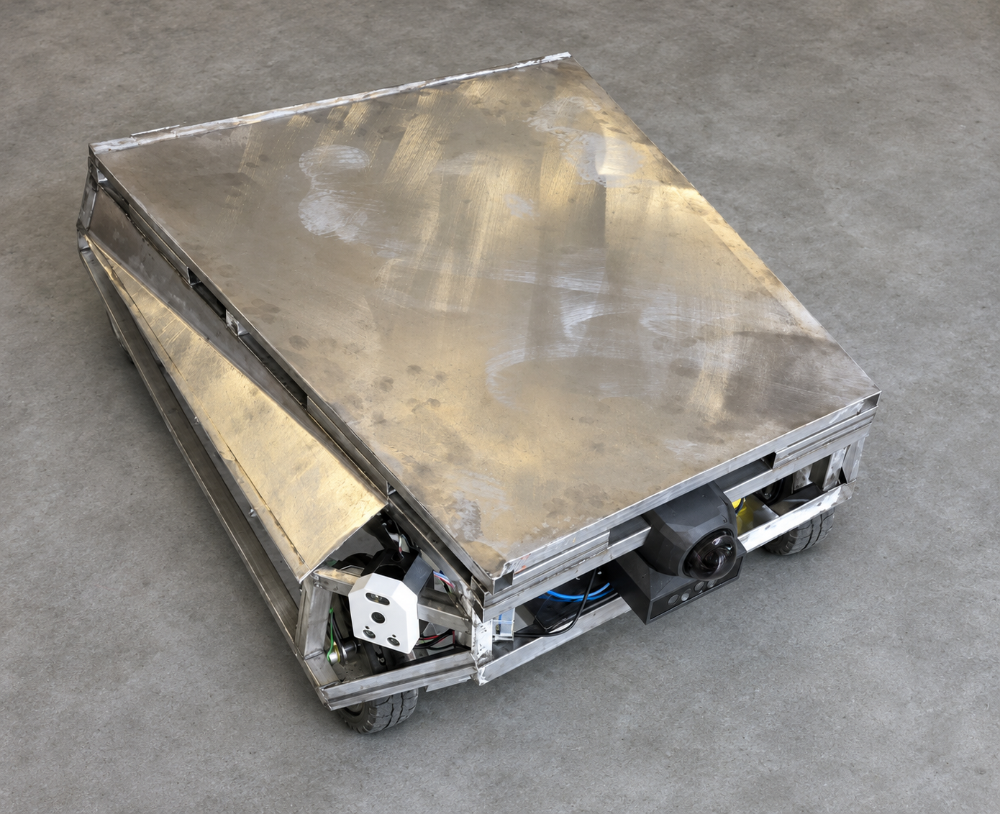
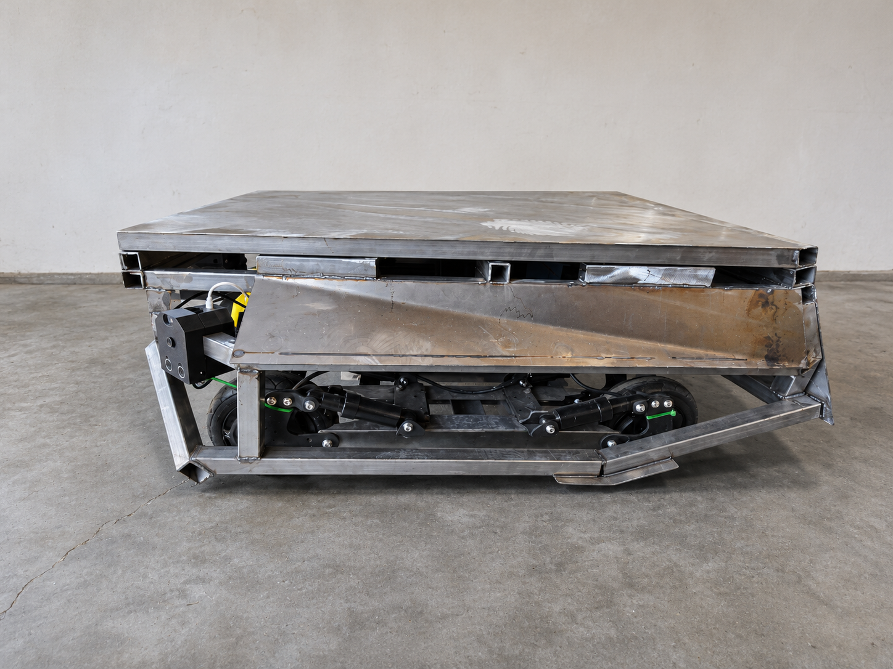
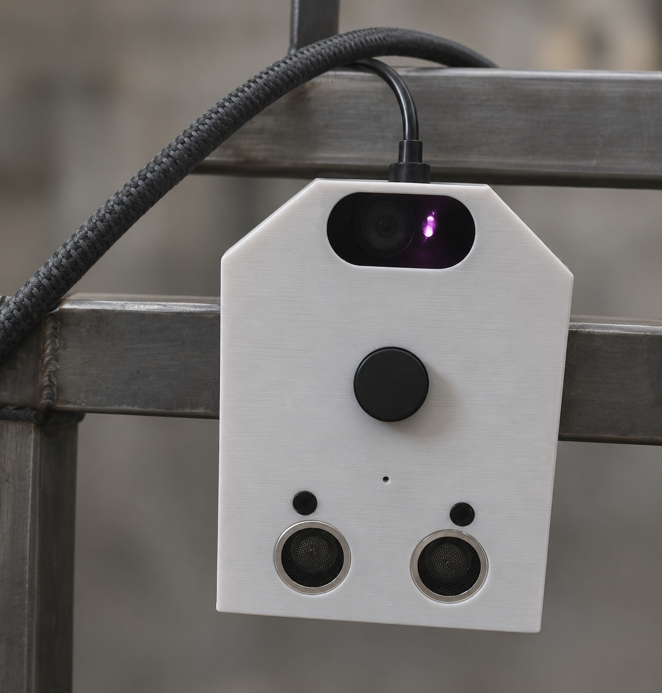

# OrinBot fabrication photos

These user-supplied build-stage photos show the chassis while weld cleanup and panel covering were still underway, plus an installed shoulder sensor prototype. Their backgrounds were simplified for presentation with ImageGen. They are **edited photographs**, so use the unedited [report build photo](assets/physical-platform.png), [CAD and installed shoulder comparison](build-and-system-figures.md#custom-shoulder-sensor-module), and project recordings for primary engineering evidence. No edited photo should be presented as a finished robot or a performance test.

## Isometric fabrication view

The top and side panels still show their unfinished metal surface, and the front openings and mounted sensors remain visible. Background clutter was removed to make the robot easier to inspect.

## Side fabrication view

This angle exposes the lower frame, wheels and suspension. It documents a stage of fabrication, not final fit or mechanical validation.

## Front shoulder sensor prototype

The close-up shows the printed housing and sensor openings on the frame. Its simplified background is a presentation edit; the [report figure](build-and-system-figures.md#custom-shoulder-sensor-module) includes the original CAD view and installed prototype photo.

## Editing scope

Built-in ImageGen edit mode was used to simplify unrelated workshop background clutter and floor distractions, with neutral lighting and modest reframing. The requested constraint was to retain the robot's unfinished welds, panel gaps, mounts, wiring and sensor arrangement. Generative edits can subtly alter hardware pixels, so these presentation versions should not replace the unedited evidence images. The RViz screenshot on the [README](../README.md) was copied unchanged from the user-supplied capture.
