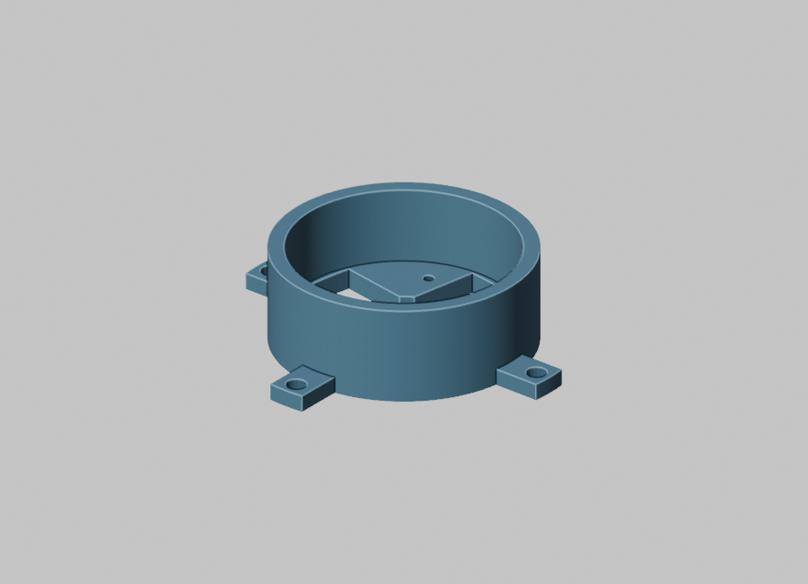
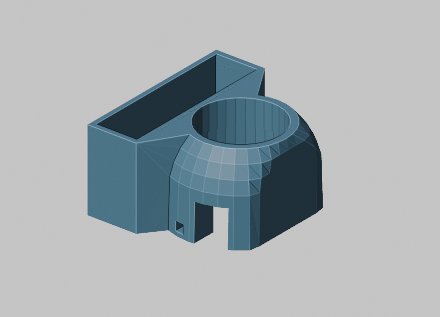
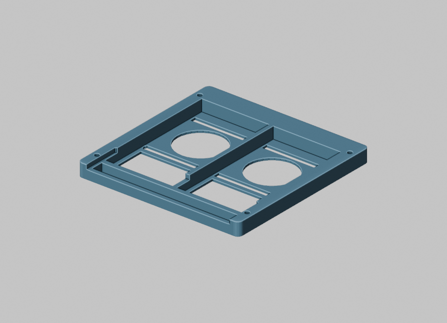
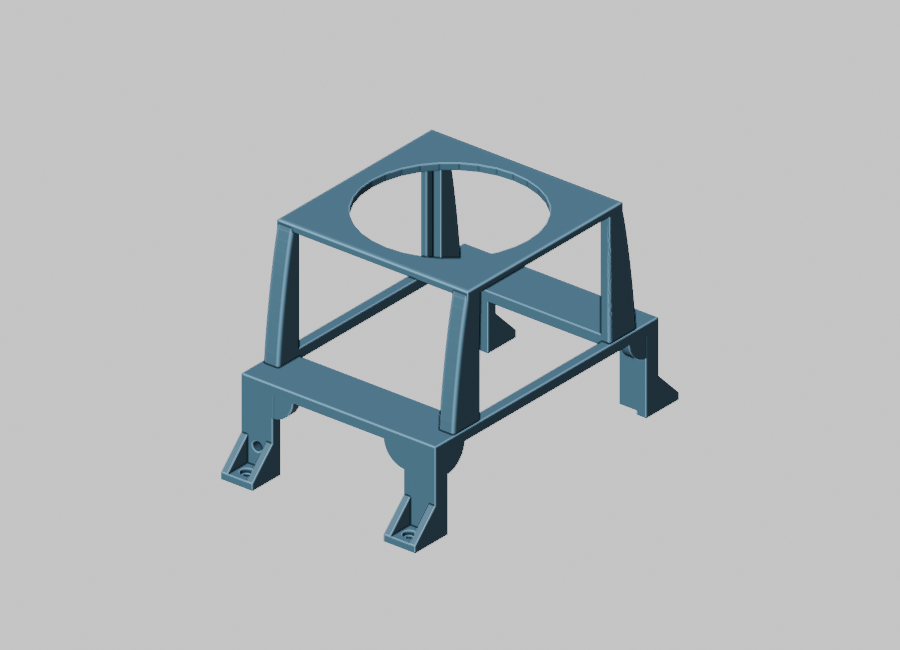
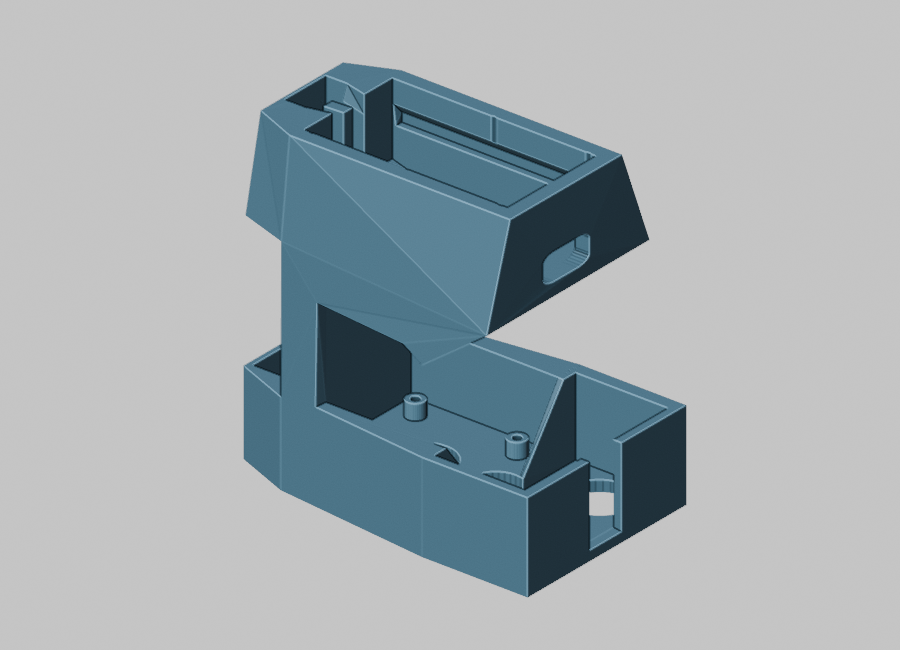
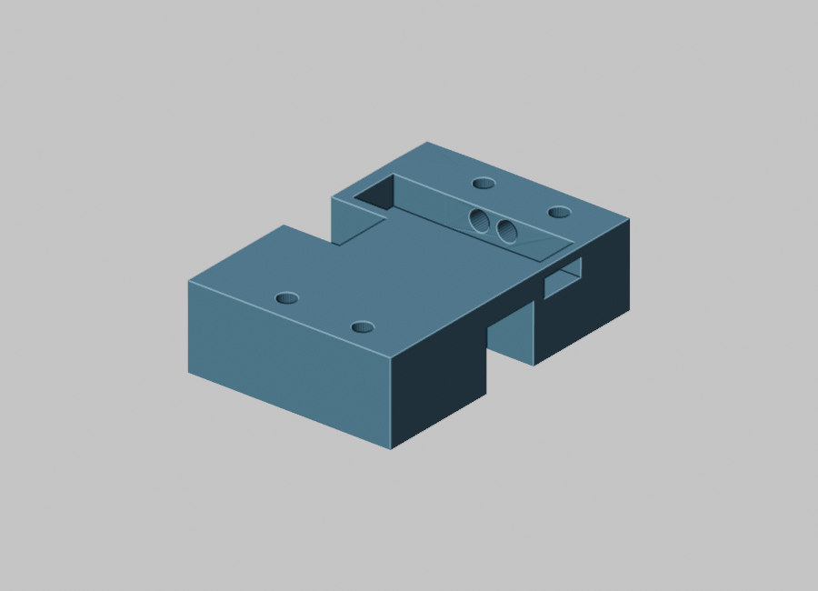

# CAD and rapid mount iteration

The robot's mounting geometry changed as the chassis, power hardware, sensor fields of view and cable routes came together. The team used CAD to produce brackets, sensor housings and equipment mounts on the fly, then exported STL files for fabrication. This is part of the integration story: a correct ROS frame depends on where a sensor can actually be mounted, and the final mount has to clear surrounding hardware and wiring.

These images are **renders of local STL exports**, made with Blender 5.0 for this portfolio. They show design geometry, not photographs of finished prints or proof that each particular revision was installed. The STL files were left in the team's local archive; the original meshes were not changed for these renders. The [final report](build-and-system-figures.md#custom-shoulder-sensor-module) supplies a separate CAD-and-installed-photo pair for one shoulder sensor housing.

| LiDAR base plate | LiDAR and camera tubing mount |
| --- | --- |
|  |  |
| Local export: `LIDAR BASE PLATE.stl`. A related editable Blender file is present in the local source archive. | Local export: `Lidar c am box tubing mount.stl`. This illustrates a different mounting arrangement, not a measured comparison of sensor offsets. |

| Dual VESC mount | PoE equipment box |
| --- | --- |
|  |  |
| Local export: `2X FLIPSKY MOUNT.stl`. Related Flipsky mount Blender work files are present locally; the exact export lineage has not been confirmed. | Local export: `poe box.stl`. The render shows modeled packaging space; it does not document final network wiring. |

| Camera clip housing | CAN tubing bracket |
| --- | --- |
|  |  |
| Local export: `Camera clip with box.stl`. It shows how the camera attachment and enclosure were treated as a single fit problem. | Local export: `Can bus 1in tubing bracket.stl`. It shows a routing/mount concept for a physical data-bus component. |

The archive also contains editable Blender files for LiDAR and VESC mounts. Native SolidWorks part and assembly files for a later attention-head design are dated May 22–23, 2026, after the May 13 final report copy. They support continued CAD exploration but are not labeled here as installed semester hardware. Dimensions, exact revisions used on the robot, printer settings and measured fit should be added alongside build photos or a fabrication log before those claims are made.
