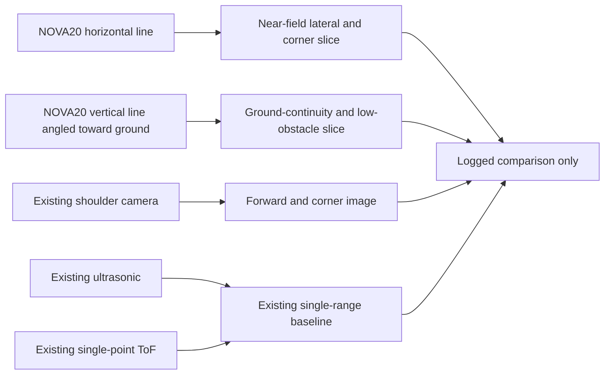

# Proposed NOVA20 side-mount sensor comparison

**Status: proposed, unpurchased and untested on OrinBot.** The present front-left and front-right shoulder modules each contain a camera, an ultrasonic sensor and a single-point ToF sensor. The existing bags record left/right ToF and ultrasonic topics; they do not demonstrate shoulder camera image recording or a NOVA20. The forward OAK camera and its detections are an existing strength and remain in the design. This proposal concerns the **side mounts**: keep their baseline sensors and topics while assessing whether a channelized near-field line helps characterize corners, low obstacles and ground discontinuities. OAK detections can feed a future planner on the Orin, but planner behavior and spare compute headroom have not been measured here.

## Candidate and geometry

Benewake's [NOVA20 product page](https://ai.benewake.com/en/products/nova20/) and [V2.1 datasheet](https://ai.benewake.com/en/resources/technical-documents/nova20-datasheet/) describe 20 channel-tagged distances across up to 40 degrees (±20 degrees), at 10 Hz over UART. The datasheet lists 1 m measurement capability at 10% reflectivity and 100 klux, 5 V ±5% supply, default 921600 baud, less than 1 W average power, less than 850 mA startup peak current, and distance/signal-strength/channel/temperature output. It lists a blind zone of **up to 0.1 m**; some Benewake application material says 0.05 m and discusses configurable frame rates. Confirm the exact hardware and firmware revision before designing around either value. The bare module has no stated protection rating. These are manufacturer specifications, not OrinBot measurements.

The suggested cross uses **two modules per shoulder** after a single-module pilot:

The horizontal fan would sample several lateral directions at a chosen height. The vertical fan would sample several elevations and, if pitched appropriately, ground ahead of the wheel path. Two perpendicular **1D slices do not make a dense 2D image or 3D point cloud**. Their intersection is limited; mounting height, pitch, yaw and the robot's bodywork determine what they actually see. A single vertical pilot is the quickest way to test the drop-off hypothesis before committing to four modules, custom crossed housings and four UART paths. A horizontal pilot can then test whether channel position improves corner observations over the current single-point sensors. Benewake describes horizontal and vertical mounting applications but explicitly requires robot-level validation of the final placement and control behavior. [Horizontal application](https://en.benewake.com/ApplicationCases/info_itemid_6190.html); [vertical application](https://en.benewake.com/ApplicationCases/info_itemid_6191.html).

## Comparison architecture

1. Bench one module first with the vendor's serial protocol. Preserve raw channel ID, distance in millimeters, return strength, status/invalid returns, temperature and host receive timestamp. Confirm whether the device supplies an acquisition timestamp or scan/frame boundary. The V2.1 datasheet shows a nine-byte channel packet, but it does not by itself explain how to reconstruct complete scans under packet loss.
2. Use a dedicated UART/USB serial path at the confirmed baud rate and a measured 5 V supply. The existing [RDK X5 range bridge](../rdk_x5/sensor_bridges/range_bridge/tof_bridge.py) consumes text at 115200 baud for the current sensors; its parser and serial ports should remain unchanged. A separate read-only bridge can publish the new channel data under names such as `/nova20/front_left/vertical` with its own frame and log.
3. Record both raw and interpreted channel data alongside existing `/tof_front_left/tof`, `/tof_front_left/ultrasonic`, their right-side equivalents, camera observations when available, TF and the main LiDAR. Preserve both acquisition and arrival times when possible. Compare the same surveyed object or edge and report time separation, rather than treating messages in one bag as synchronized.
4. Keep this as a measurement branch. No NOVA20 output should command a motor, declare a safe path or replace the existing collision logic until a separate robot-level control and failure test is designed.

## Bench and robot tests

| Question | Controlled setup | Measure |
| --- | --- | --- |
| Does one line add useful spatial detail? | At known distances and lateral offsets, place narrow posts, chair legs and a wall edge across the 40-degree fan. Repeat for both shoulders and compare with existing ToF/ultrasonic and camera observations. | Per-channel range error, valid-return fraction, which channels respond, missed narrow targets, false returns and frame gaps. |
| Can a vertical fan distinguish a ground drop? | With the robot immobilized, use measured flat floor, curb/step and drop-off fixtures at several standoff distances. Vary floor color/reflectivity, sunlight, body pitch and sensor height/angle. | Ground-return pattern versus measured geometry, detection lead distance, false alarms on dark/reflective surfaces and no-return ambiguity. |
| Does the cross help more than one module? | Repeat the same fixtures with vertical only, horizontal only and both. Keep other sensors and geometry fixed. | Incremental correct observations, blind zones, overlap, timing mismatch and cost/complexity per added module. |
| Is the physical integration viable? | Test cable routing, module orientation, window/cover and power with the existing shoulder camera/ToF/ultrasonic hardware. | Mount repeatability, window effect, startup current, UART packet loss and thermal behavior. |

A missing or weak ground return could mean a drop-off, dark material, glare, occlusion or a packet problem. It is **not** by itself a verified drop-off event or a collision-safety function. Sensor comparisons should remain stationary or manually controlled until the robot's steering and braking behavior are validated.

## Vendor questions before a purchase or sample decision

- Which NOVA20 revision and firmware would be supplied, and which blind-zone and frame-rate specifications apply? The V2.1 datasheet says 0.1 m and 10 Hz; some current application pages state 0.05 m and configurable 5/10/25/50 Hz.
- What are the channel center angles and ordering when the module is rotated 90 degrees? Is per-unit angle/range calibration provided?
- How are 20 channel packets grouped into one scan? What checksums, invalid-range codes, status flags and acquisition timestamps are available?
- What are the 5-pin connector pinout, UART logic levels, cable limits, recommended power filtering, and outdoor optical-window constraints?
- Is there a sample or evaluation unit, price and lead time for a one-module comparison before considering a four-module cross?
