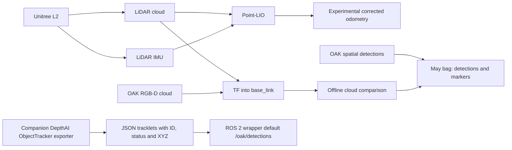

# LiDAR and vision perception evaluation

## Pipeline and evidence boundary

The [Unitree L2 driver in Orinbot](https://github.com/kenner1-unlv/Orinbot/blob/main/src/unitree_lidar_ros2/launch/launch.py) is configured to publish `unilidar/cloud` and `unilidar/imu`. The [Point-LIO configuration](https://github.com/kenner1-unlv/Orinbot/blob/main/third_party/point_lio_ros2/config/unilidar_l2.yaml) consumes those topics; the [corrected-odometry launch](https://github.com/kenner1-unlv/Orinbot/blob/main/third_party/point_lio_ros2/launch/correct_odom_unilidar_l2.launch.py) requests `odom_only` output with `odom` and `base_link` frames. This matches the LiDAR, IMU and `/odom_corrected` topics found in the short bag. It does not by itself validate motion accuracy.

The [companion exporter](https://github.com/kenner1-unlv/Orinbot/blob/main/tools/oak_detections_app/main.py) constructs a YOLOv6-nano spatial detection network and DepthAI `SHORT_TERM_IMAGELESS` tracker, then emits tracklet ID, lifecycle status, class and `xyz_mm`. Its [ROS 2 wrapper](https://github.com/kenner1-unlv/Orinbot/blob/main/tools/oak_detections_app/oak_detections_node.py) publishes JSON on `/oak/detections` by default. That topic is absent from the five May bag metadata files, so the companion code is an implementation artifact rather than recorded proof of object/person tracking in these runs. The May OAK spatial-detection and marker streams may come from a different runtime pipeline; their exact producer should be identified before combining claims.

## Existing short bag: measured diagnostic

Source: `rosbags/orinbot_integrated_20260507_124955`, recorded May 7, 2026. The checked-in `.db3` is a Git LFS object. Results below came from decoding that database with `tools/inspect_perception_bag.py` using `rosbags`, NumPy and SciPy. This is a 9.46-second integrated capture, not a controlled calibration run.

- 113 Unitree L2 clouds, 36 OAK RGB-D clouds, 130 OAK RGB images, 146 OAK spatial detection messages, 108 visualization marker messages.
- The recorded TF graph connects `unilidar_lidar` and `oak_rgb_camera_optical_frame` to `base_link`. Its nominal origins in `base_link` are approximately `(0.263, 0.015, 0.222) m` and `(0.270, 0.000, 0.300) m`, respectively. These are **configured transforms**, not measurements of physical mounting accuracy.
- The OAK cloud's recording timestamp minus its message-header timestamp has median 0.827 s and 90th percentile 1.277 s. The LiDAR cloud's corresponding values are 0.085 s and 0.087 s. These differences can reflect pipeline latency, buffering or clock behavior; the bag alone does not isolate the cause.
- Three OAK clouds were sampled across the recording and paired with the LiDAR cloud with nearest **header** timestamp. Pair gaps were 0.026, 0.037 and 0.030 s. Both clouds were transformed into `base_link` using recorded TF. Finite points within 0.2–8 m of each sensor were retained; at most 10,000 LiDAR and 6,000 OAK points were sampled per pair. Distances are OAK-to-nearest-LiDAR-point in the combined frame.

| Pair | Median nearest-neighbor distance | 90th percentile | OAK points within 0.25 m | Median XYZ residual among points within 0.5 m |
| --- | ---: | ---: | ---: | --- |
| Early | 0.143 m | 0.545 m | 72.6% | `(0.000, 0.004, -0.079) m` |
| Middle | 0.584 m | 1.761 m | 42.7% | `(-0.002, -0.003, -0.101) m` |
| Late | 0.393 m | 1.084 m | 25.9% | `(-0.185, -0.014, -0.009) m` |

These residuals vary with field of view, range, occlusion, motion, density and timing. Nearest neighbors may belong to different physical surfaces. The script uses the first recorded transform for each frame relationship; it does not interpolate a moving transform per cloud. The table is a **scene overlap diagnostic**, not an extrinsic translation estimate, calibration success score, or claim of fused obstacle tracking. Repeat it on a stationary target with known geometry before interpreting the residual vector as sensor offset.

The visualization marker stream had 88 empty messages and 20 messages with two markers. The text labels were `chair` in 17 messages and `bed` in three. The Euclidean norms of the label-marker 3D positions were 3.40–5.65 m for chair (median 4.47 m) and 1.35–1.39 m for bed (median 1.37 m). These are reported positions in the OAK optical frame, not checked distances to measured targets. They show spatially located object labels were emitted in this capture. Marker IDs are display IDs; they are not persistent object identities. This short recording does not demonstrate person detection or person tracking. The OAK detection topic has messages, but its custom `vision_msgs/Detection3DArray` contents need the exact message definition and a dedicated evaluation before class, confidence, depth accuracy or identity persistence can be claimed.

## Calibration test to perform

1. Immobilize the chassis and record the physical mount positions. Put a planar board or rigid target visible to both sensors at at least five measured positions across the common field of view, including near/far and left/right placements.
2. Record raw LiDAR and OAK point clouds, both message headers, TF, camera intrinsics, and a visible target annotation. Confirm sensor clocks or measure their offset. Do not use recording arrival time as a substitute for acquisition time.
3. Segment the same target in each modality. Transform points into `base_link`, fit the plane or target center independently, and report per-position center/plane residuals. Estimate translation and rotation corrections with a holdout target position; report median, 95th percentile and repeatability across runs.
4. Repeat after removing and remounting either sensor. Compare the result to the configured TF and update the URDF/TF only when measurements support it.

## Distance and object/person evaluation to perform

For distance, place a target at surveyed ranges, record RGB-D reported range and LiDAR range to the **same target**, and report signed error and absolute error by range. For object tracking, record raw RGB images, spatial detections with class/confidence and 3D coordinates, and annotated ground-truth positions and identities over time. Evaluate detection recall, range error, track continuity and identity switches separately for stationary objects, moving objects and people. Use an independent held-out run. The current bag supports a narrower claim: simultaneous LiDAR, RGB-D and spatial-label publication in one ROS 2 system, with measurable but variable point-cloud scene overlap.
